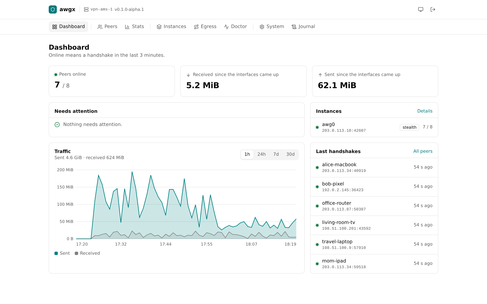
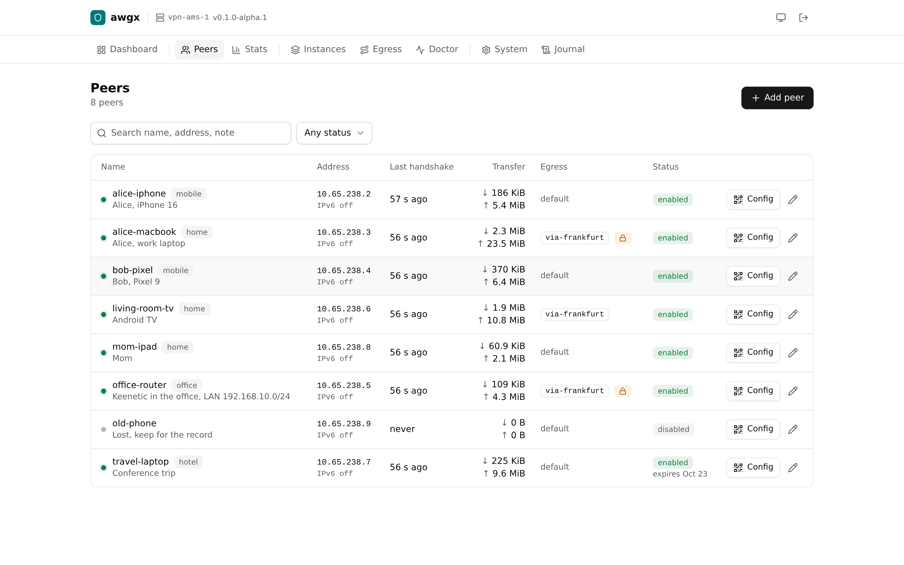
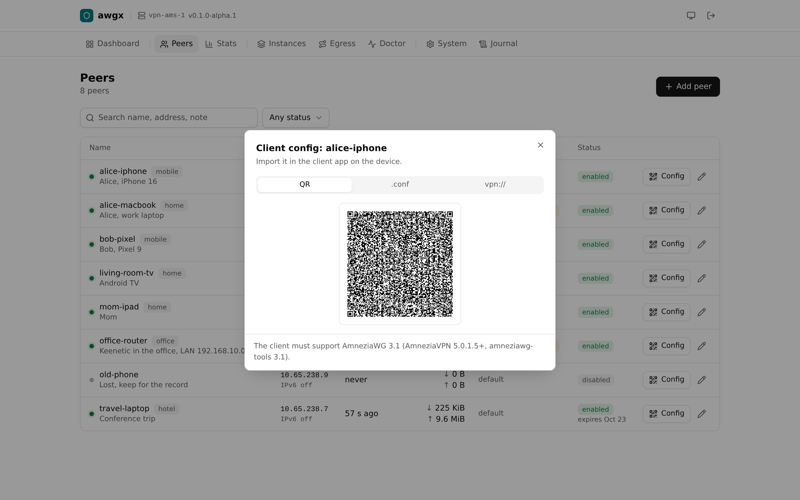
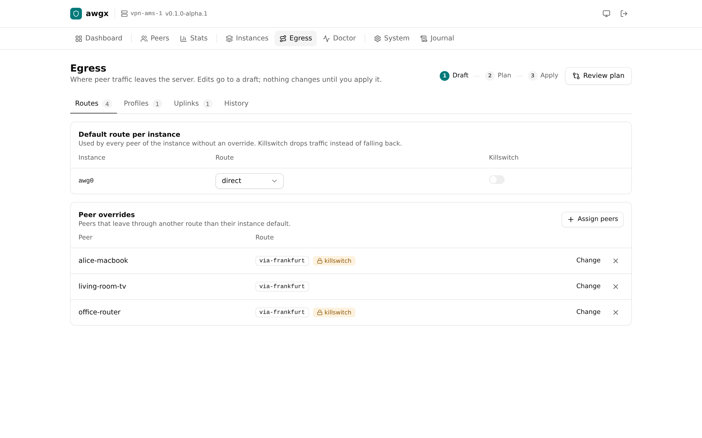
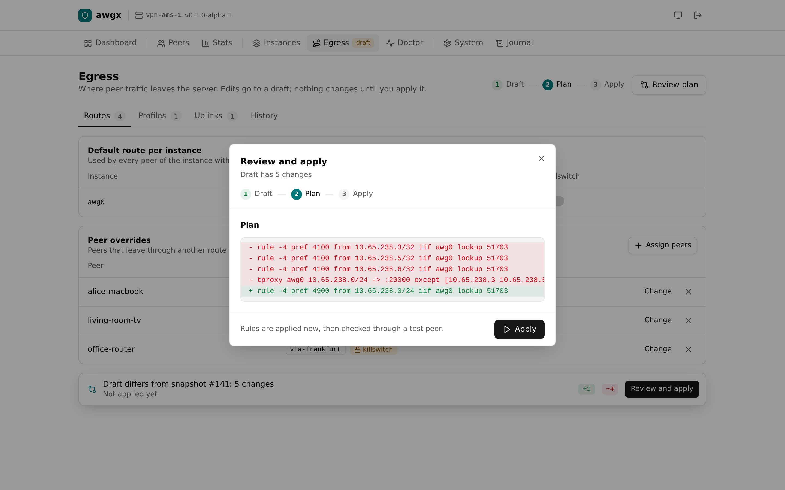
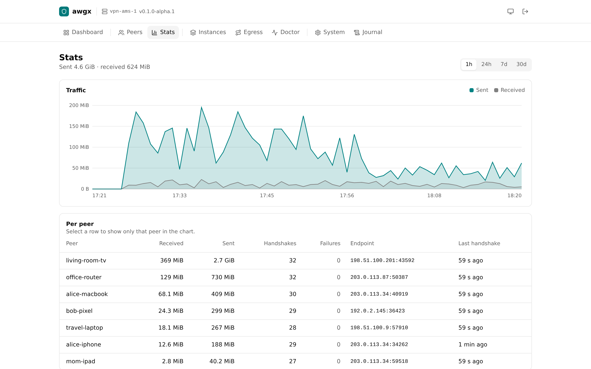
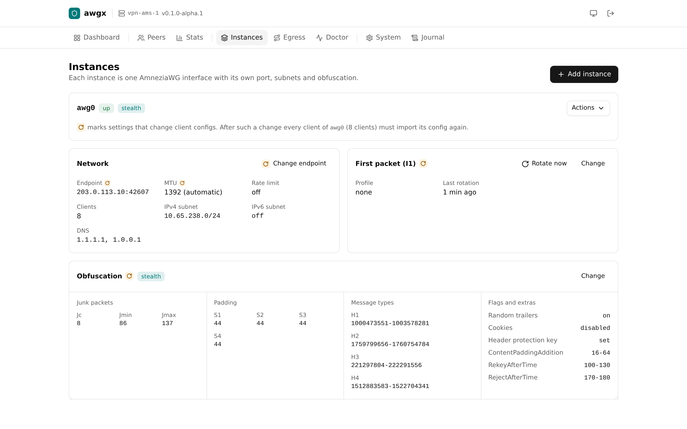
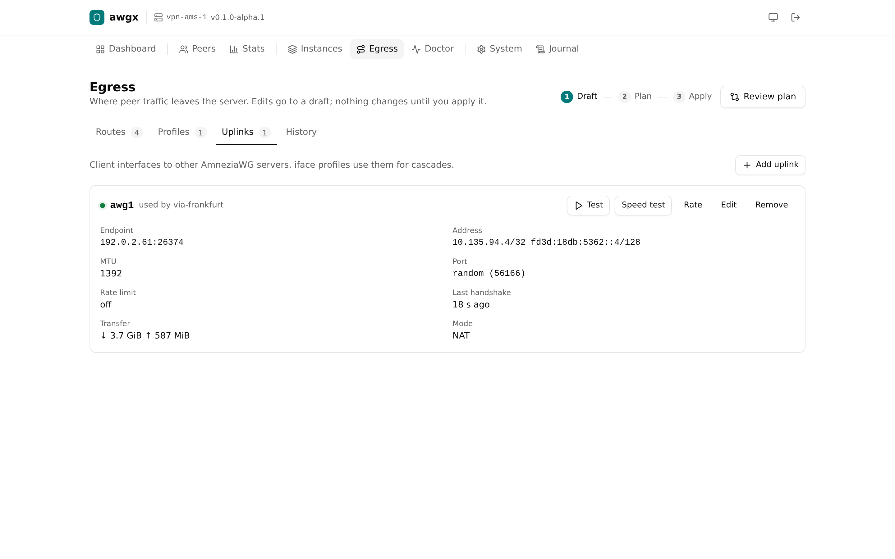
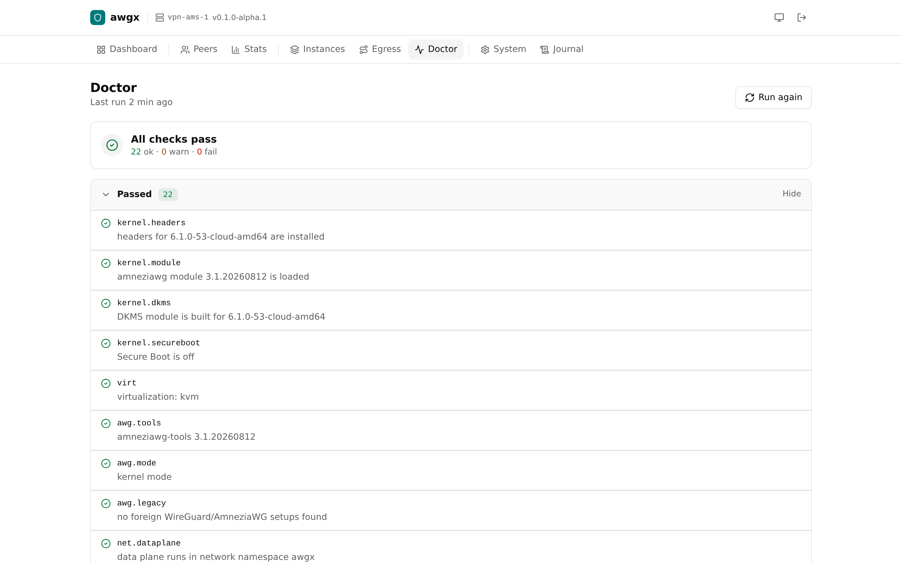
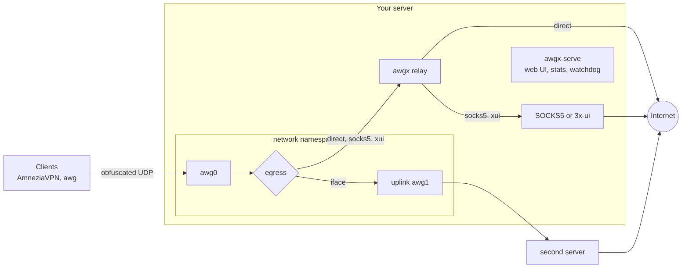

<p align="center">
  
</p>

<h1 align="center">awgx</h1>

<p align="center">
  <b>Your own AmneziaWG server in one binary.</b><br>
  Install with one command, manage peers from a web UI, chain servers into cascades<br>
  and route clients through 3x-ui, without touching the host firewall.
</p>

<p align="center">
  <a href="https://github.com/k2so-dev/awgx/releases"></a>
  <a href="https://github.com/k2so-dev/awgx/actions/workflows/ci.yml"></a>
  
  <a href="LICENSE"></a>
</p>

<p align="center">
  <a href="#quick-start">Quick start</a> ·
  <a href="#features">Features</a> ·
  <a href="#screenshots">Screenshots</a> ·
  <a href="#how-it-works">How it works</a> ·
  <a href="#reference">Reference</a> ·
  <a href="#roadmap">Roadmap</a>
</p>

<picture>
  <source media="(prefers-color-scheme: dark)" srcset="docs/screenshots/dashboard-dark.png">
  
</picture>

> [!WARNING]
> **awgx is in alpha.** Commands, the state format and defaults can still change between releases. Please [open an issue](https://github.com/k2so-dev/awgx/issues) when something breaks.

awgx installs, configures and maintains an [AmneziaWG](https://docs.amnezia.org/documentation/amnezia-wg/) 3.1 server on the kernel module. It is a single static Go binary with a CLI and an embedded web UI. Every config it generates passes a strict validator, and every change shows its plan before it is applied.

awgx is unofficial and not affiliated with Amnezia.

## Quick start

```sh
curl -fLo /usr/local/bin/awgx https://github.com/k2so-dev/awgx/releases/download/v0.1.0-alpha.1/awgx-linux-amd64
chmod +x /usr/local/bin/awgx
sudo awgx setup
```

Use `awgx-linux-arm64` on ARM servers. Every release also has `checksums.txt` and a minisign signature for each binary.

`setup` checks the system, shows the full list of changes and asks once. It applies the recommended fixes, installs the kernel module from the Amnezia PPA, generates an instance, runs a handshake self-test and creates the first client with a QR code for AmneziaVPN. Then:

```sh
awgx peer add laptop       # another client, QR code in the terminal
awgx web passwd            # set a password for the web UI
awgx web enable            # starts awgx-serve, the UI is on 127.0.0.1:7457
ssh -N -L 7457:127.0.0.1:7457 root@SERVER   # open http://127.0.0.1:7457
```

## Features

<table>
<tr>
<td width="50%" valign="top">

**🚀 One binary, one command**<br>
Static Go binary for amd64 and arm64. `awgx setup` goes from a clean Debian or Ubuntu to a working server with a client QR code; run it again later for maintenance.

</td>
<td width="50%" valign="top">

**🖥️ Web UI built in**<br>
Dashboard, peers with QR and `vpn://` export, traffic charts, egress, doctor, backups and updates. Light and dark themes. The page loads nothing from other hosts: no CDN, no telemetry.

</td>
</tr>
<tr>
<td valign="top">

**🥷 Obfuscation presets**<br>
`balanced`, `stealth` and `speed` presets, or every AmneziaWG 3.1 parameter by hand. The I1 first packet can look like QUIC, STUN or DNS, per instance or per peer.

</td>
<td valign="top">

**🔀 Cascades and 3x-ui**<br>
Send all peers or single ones through another AmneziaWG server, a SOCKS5 proxy or Xray of the local 3x-ui, with a killswitch, failover and health checks every 30 seconds in the `awgx-serve` daemon.

</td>
</tr>
<tr>
<td valign="top">

**🛡️ Safe changes**<br>
Egress changes are a draft until you apply them. Apply shows the plan, checks the route first, sends a test peer through it afterwards, and any recent snapshot can be rolled back.

</td>
<td valign="top">

**🧱 Leaves your firewall alone**<br>
Peer traffic lives in its own network namespace, so ufw rules, Docker and the host routes do not see it. awgx only opens the UDP port and adds one link from the host into the namespace.

</td>
</tr>
<tr>
<td valign="top">

**🩺 Doctor and perf**<br>
`awgx doctor` checks the kernel, module, ports, firewall, DNS, buffers and state, and fixes what it can. `awgx perf` finds what limits the speed and says what to change.

</td>
<td valign="top">

**🔁 Maintenance**<br>
Traffic statistics for 90 days, peer expiry and I1 rotation in `awgx-serve`; module upgrade with rollback, signed self-update, backup and restore, Prometheus metrics.

</td>
</tr>
</table>

## Screenshots

<table>
<tr>
<td width="50%"><b>Peers</b><br>
<picture><source media="(prefers-color-scheme: dark)" srcset="docs/screenshots/peers-dark.png"></picture></td>
<td width="50%"><b>Client config with a QR code</b><br>
<picture><source media="(prefers-color-scheme: dark)" srcset="docs/screenshots/config-dark.png"></picture></td>
</tr>
<tr>
<td><b>Egress routes and per-peer overrides</b><br>
<picture><source media="(prefers-color-scheme: dark)" srcset="docs/screenshots/egress-dark.png"></picture></td>
<td><b>Plan before apply</b><br>
<picture><source media="(prefers-color-scheme: dark)" srcset="docs/screenshots/plan-dark.png"></picture></td>
</tr>
<tr>
<td><b>Traffic statistics</b><br>
<picture><source media="(prefers-color-scheme: dark)" srcset="docs/screenshots/stats-dark.png"></picture></td>
<td><b>Instances and obfuscation</b><br>
<picture><source media="(prefers-color-scheme: dark)" srcset="docs/screenshots/instances-dark.png"></picture></td>
</tr>
<tr>
<td><b>Uplinks to other servers</b><br>
<picture><source media="(prefers-color-scheme: dark)" srcset="docs/screenshots/uplinks-dark.png"></picture></td>
<td><b>Doctor</b><br>
<picture><source media="(prefers-color-scheme: dark)" srcset="docs/screenshots/doctor-dark.png"></picture></td>
</tr>
</table>

## How it works



The awg interfaces, uplinks included, live in the network namespace `awgx`. The relay built into awgx opens the peers' TCP and UDP connections from the host, directly or through a SOCKS5 server, so the host firewall, Docker and forwarding settings do not affect peer traffic, and a broken egress cannot lock you out of SSH. The state is one SQLite file; configs are rendered from it and never edited by hand. `awgx-serve` collects statistics, reconciles the state with the kernel, probes the egress and serves the web UI; it is off until `setup --serve`, `awgx serve enable` or `awgx web enable`, and stopping it does not stop the tunnel.

## Supported platforms

| Platform | Kernel | Status |
| --- | --- | --- |
| Debian 12 | 6.1 | ✅ works |
| Debian 13 | 6.12 | ✅ works |
| Ubuntu 24.04 | 6.8 | ✅ works on the 6.8 kernel; the 7.0 HWE kernel has the 26.04 problem |
| Ubuntu 26.04 | 7.0 | ⏳ not yet: the upstream module does not build on Ubuntu 7.0.0-38 and later ([amneziawg-linux-kernel-module#259](https://github.com/amnezia-vpn/amneziawg-linux-kernel-module/issues/259)) |

amd64 and arm64, KVM or bare metal, systemd, root. Containers (LXC, OpenVZ) cannot load kernel modules.

awgx works only with the AmneziaWG kernel module and carries no patches of its own for it. When the module from the PPA does not build for the running kernel, `install` rolls the packages back and stops. There is no userspace mode: on such kernels use another tool, for example the AmneziaWG inbound of 3x-ui.

## Reference

<details>
<summary><b>Setup and install</b></summary>

`setup` checks the system, applies the recommended doctor fixes, installs the kernel module with the chosen scenario (`--scenario standard|stealth|speed`, IPv6 inside the tunnel with `--ipv6 auto|on|off`), finds the public address (asks api.ipify.org, ifconfig.me as a fallback; `--no-public-ip` skips it) and creates the first clients with QR codes and configs in `/root/awgx-clients` (`--client NAME`, `phone` by default). `--serve` enables the `awgx-serve` background service (traffic stats, client expiry, egress failover, update check); `awgx serve enable|disable` turns it on and off later. Old WireGuard/AmneziaWG setups are reported; `--remove-old` removes them, `--backup-old` archives them first. It prints the full list of changes and asks before doing anything; `--yes` skips the question. Run again on an installed server it applies the pending fixes, adds the requested clients, changes the endpoint (`--endpoint`) and IPv6 (`--ipv6`) and turns on `awgx-serve` with `--serve`, without reinstalling. The web UI, a cascade and 3x-ui egress are turned on with `awgx web enable`, `awgx uplink add` and `awgx xui connect`, or in the web UI setup.

The same steps by hand:

```sh
awgx doctor
awgx install
awgx peer add phone
```

`install` runs the preflight doctor, adds the Amnezia PPA as `/etc/apt/sources.list.d/awgx-amnezia.list` (Debian 12 and 13 use its jammy and noble builds), installs `amneziawg-dkms`, `amneziawg-tools`, dkms, kernel headers and nftables, generates the instance, starts `awgx-dataplane.service` and runs a self-test: a test peer in a network namespace must complete a handshake. `peer add` prints a QR code for AmneziaVPN.

`awgx` without arguments prints the list of commands.

</details>

<details>
<summary><b>Commands</b></summary>

| Command | Description |
| --- | --- |
| `awgx setup [--yes]` | First run, maintenance on an installed server |
| `awgx doctor [--fix] [--json]` | System checks; exit code 0 ok, 1 warnings, 2 failures |
| `awgx install [--preset P] [--port N] [--endpoint IP] [--i1 PROFILE] [--remove-old] [--backup-old] [--serve]` | Install and start the first instance `awg0` |
| `awgx instance {add,rm,ls,set}` | More instances with their own port, preset, I1 and subnet; `set --endpoint` changes the address clients use, `set --mtu N\|auto` fixes the tunnel MTU, `set --rate MBIT\|off` limits the speed |
| `awgx purge [--backup] [--legacy]` | Remove everything awgx created, and old AWG/WG setups on request |
| `awgx gen [--preset P \| --set KEY=VALUE] [--dry-run] [--import FILE]` | Regenerate parameters, set single ones, or validate an existing AmneziaWG `.conf` |
| `awgx i1 {show,gen,rotate,ab}` | Manage the I1 packet |
| `awgx peer {add,rm,ls,show,qr,export,set,expire}` | Manage peers live |
| `awgx stats [--peer X] [--since 24h] [--by-i1] [--net L]` | Traffic, handshakes, I1 A/B comparison |
| `awgx serve [enable\|disable]` | Daemon run by `awgx-serve.service`; `enable` and `disable` turn it on and off |
| `awgx upgrade [--self] [--channel stable\|beta] [--check] [--auto-check on\|off]` | Upgrade module and tools with rollback, or awgx itself |
| `awgx backup [--out DIR]`, `awgx restore FILE` | tar.zst archive of the state and configs |
| `awgx reinstall [--regen-server] [--from BACKUP]` | purge + install keeping peers and keys |
| `awgx selftest` | Handshake from a test peer in a network namespace |
| `awgx egress {ls,add,set,rm,use,plan,apply,rollback,reset,status}` | Route peers through other interfaces or SOCKS5 |
| `awgx uplink {add,set,rm,ls,test,speed}` | Client awg interfaces to other servers, for cascades; `speed` measures one |
| `awgx xui {connect,status,disconnect}` | SOCKS5 inbound in the local 3x-ui as an egress |
| `awgx perf [mtu,cpu,throughput,agent]` | What limits the speed, with concrete advice |
| `awgx web {enable,disable,passwd,status,metrics}` | Built-in web UI |
| `awgx version` | Print the version |

Every command takes `--instance NAME` (`-i`); without it awgx works with `awg0`, or with the only instance there is.

Listing and status commands (`doctor`, `peer ls/show`, `instance ls`, `i1 show`, `stats`, `egress ls/plan/apply/status`, `uplink ls`, `xui status`, `perf`, `web status`) accept `--json`; `peer export --format json` prints JSON.

</details>

<details>
<summary><b>Presets, I1 profiles and an example config</b></summary>

| Preset | Jc | S1-S4 | Extras |
| --- | --- | --- | --- |
| `balanced` | 4-6 | 15-44, independent | header protection |
| `stealth` | 4-8 | 24-44, equal | header protection, random trailers, disabled cookies, content padding 16-64, timing ranges |
| `speed` | 2-3 | 12-16 | header protection |

H1-H4 are random ranges that never overlap. `--random-trailers` and `--disable-cookies` override the preset on `install` and `gen`. Presets keep S4 at 44 or lower, and awgx writes the MTU into every client config. What each parameter does is described in the [AmneziaWG documentation](https://docs.amnezia.org/documentation/amnezia-wg/).

| I1 profile | Client sends | Port |
| --- | --- | --- |
| `none` (default) | nothing, only junk packets | any |
| `noise` | 32-64 random bytes | any |
| `quic` | a QUIC v1 Initial with a TLS 1.3 ClientHello (chrome, firefox, safari), 1200 bytes | 443/udp |
| `stun` | a STUN Binding Request | any |
| `dns` | a DNS query | 53/udp |
| `custom` | your CPS string | any |

The profiles imitate only the first packet. A peer can override the instance profile: `awgx peer set NAME --i1 stun`. Static profiles are rotated with `awgx i1 rotate`.

For full control pick the `custom` preset when adding an instance in the web UI (Instances, Add), or press Change in the Obfuscation card of an existing instance; from the shell, `awgx gen --set S1=40 --set H1=100-200` changes single parameters. The form starts from preset values, shows the limit of every field and runs the same checks as `awgx gen`. `awgx gen --preset NAME` switches a custom instance back to a preset.

A client config of a `stealth` instance, as `awgx peer export` prints it (keys replaced):

```ini
[Interface]
PrivateKey = <client private key>
Address = 10.65.238.2/32
DNS = 1.1.1.1, 1.0.0.1
MTU = 1392
Jc = 8
Jmin = 86
Jmax = 137
S1 = 44
S2 = 44
S3 = 44
S4 = 44
H1 = 1000473551-1003578281
H2 = 1759799656-1760754784
H3 = 221297804-222291556
H4 = 1512883583-1522704341
HeaderProtectionKey = <header protection key>
RandomTrailers = on
DisableCookies = on
ContentPaddingAddition = 16-64
RekeyAfterTime = 100-130
RejectAfterTime = 170-180

[Peer]
PublicKey = <server public key>
PresharedKey = <preshared key>
Endpoint = 203.0.113.10:42607
AllowedIPs = 0.0.0.0/0, ::/0
PersistentKeepalive = 20-30
```

</details>

<details>
<summary><b>Instances</b></summary>

One instance is one AmneziaWG interface: its own UDP port, preset, I1 profile, keys, subnet and peers. Junk packets, S1-S4 and H1-H4 are per instance, so a second instance is the way to offer, for example, `stealth` with a QUIC I1 on 443/udp next to `speed` on a random port:

```sh
awgx instance add awg2 --preset stealth --i1 quic --sni www.google.com --port 443
awgx peer add phone -i awg2
awgx instance ls
awgx instance rm awg2      # the interface and its peers are gone
```

The endpoint is taken from the first instance. `serve` collects statistics, reconciles, expires peers and rotates I1 on every instance; `doctor` checks the port, mode and state of each; egress assignments are per instance (`awgx egress use PROFILE -i awg2`). In the CLI `-i NAME` selects the instance, the web UI shows all of them. Stopping one instance leaves the routing and firewall rules of the others in place.

</details>

<details>
<summary><b>Egress: cascades, SOCKS5 and 3x-ui</b></summary>

Peers go out directly by default: the relay built into awgx opens their TCP and UDP connections from the host, and ping is answered with real pings from the host. The awg interfaces live in the network namespace `awgx`, so ufw, firewalld, docker and forwarding settings of the host do not affect peer traffic; peers reach the host itself through a link named like the instance (`awg0`), and the host firewall applies to it as usual (with firewalld awgx puts that link into the `trusted` zone). See [docs/egress.md](docs/egress.md). An egress profile sends them elsewhere:

- `iface`: policy routing into another interface, for example an uplink to a second AmneziaWG server (cascade). Several interfaces give failover in order.
- `socks5`: the relay built into awgx sends TCP and UDP through a SOCKS5 server; UDP needs SOCKS5 UDP ASSOCIATE and is checked before apply.
- `xui`: the same through Xray of the local 3x-ui; awgx creates a `mixed` inbound with UDP on 127.0.0.1 itself and uses it as SOCKS5.

Profiles and assignments are a draft until applied:

```sh
awgx uplink add awg1 --conf upstream.conf
awgx egress add cascade --type iface --dev awg1 --fallback direct
awgx egress use cascade --killswitch
awgx egress plan
awgx egress apply
```

`uplink add` fits the uplink MTU to this server's link: the MTU in the imported config was computed on the other server, so it is lowered when this side has a smaller link MTU or the obfuscation needs more room. Clients routed through the uplink should use that MTU or lower: `awgx instance set awg0 --mtu 1316` puts it into the server and every client config, and `egress plan` warns when an instance MTU is larger. `awgx uplink set awg1 --conf new.conf` replaces the config of an uplink in place, `--mtu N` changes its MTU and `--routed on|off` its NAT; profiles keep using it. The local UDP port of an uplink is random by default and changes whenever the interface is recreated (reboot, upgrade, `uplink set`). Providers hash paths by ports, so one port can lose UDP where another does not: `--port N` on `uplink add` or `uplink set` fixes it in the stored config, a `ListenPort` in the imported config does the same, and `--port auto` goes back to a random one. A new `--conf` without `ListenPort` keeps the fixed port, a port-only change is applied without restarting the interface, and `awgx doctor` warns when the running port differs. The web UI (Egress, Uplinks, Edit) does the same.

`apply` checks the egress first (TCP and DNS through it), stores a snapshot, applies routes, rules and the nftables table, and sends a test peer from a network namespace through the new path. If applying fails, the previous snapshot comes back at once; a failed test peer check is reported and the change stays. Egress lives in its own network namespace and never touches the host firewall or the routes to the host, so there is no confirm window. `awgx egress rollback` re-applies the snapshot before the current one, `awgx egress rollback ID` any of the last 20 snapshots; `awgx egress reset` throws away the draft and copies the applied egress back into it.

Only traffic coming from `awg0` inside the namespace is matched, so the host itself and sshd are never routed into an egress. TCP MSS is clamped to the instance MTU in both directions, so devices behind a router client still send and receive packets that fit the tunnel. Inside the namespace awgx uses routing tables 51700-52055, rule priorities 4000-4999 and the nftables table `inet awgx`. A killswitch drops traffic of the peers instead of letting it go direct when the egress is down. `awgx-serve` probes every egress profile in use every 30 s, fails over between interfaces, switches to the fallback profile and back, and repairs routes after an interface restart.

```sh
awgx xui connect --token TOKEN          # all peers into 3x-ui, killswitch on
awgx xui connect --peers alice --token TOKEN
awgx xui status
awgx xui disconnect                     # routes to direct, then the inbound is deleted
```

Create the token in 3x-ui under Settings, Security, API Token. Tokens made there have the `admin` scope; awgx only manages its own inbound, so a `node-sync` token is enough: recent 3x-ui makes one with `/usr/local/x-ui/x-ui setting -getApiToken -tokenName awgx -tokenScope node-sync`. Without `--token` awgx can run `x-ui setting -getApiToken` after a confirmation; that regenerates the `cli-fallback` token. Only the awgx relay connects to the inbound, DNS of the peers is redirected into it, and its routing, outbounds and balancers are managed in 3x-ui. awgx turns sniffing on (http, tls, quic); keep it on if 3x-ui routes by domain, because the relay passes IP addresses only.

</details>

<details>
<summary><b>Web UI</b></summary>

```sh
awgx web passwd            # argon2id; add --totp for a one-time code
awgx web enable            # served by awgx-serve on 127.0.0.1:7457
ssh -N -L 7457:127.0.0.1:7457 root@SERVER   # then open http://127.0.0.1:7457
```

The UI is embedded in the binary and the page loads nothing from other hosts (system fonts, no CDN, no telemetry), with light and dark themes. awgx itself contacts api.github.com for the daily update check (`awgx upgrade --auto-check off`), api.ipify.org or ifconfig.me in `setup`, and the Amnezia PPA during install.

- dashboard with a list of what needs attention, statistics with charts and the journal;
- peers: search, create, edit note, expiry, first packet and egress, QR, .conf, vpn://, enable, delete;
- instances: add (preset or custom parameters, with the self-test), endpoint, I1 and SNI, I1 rotation, obfuscation parameters, remove;
- egress: profiles, default routes and peer overrides with the killswitch, uplinks with a test, 3x-ui connect and disconnect, plan, apply, roll back to any of the last 10 snapshots;
- doctor with selected fixes;
- system: update check, awgx self-update, module upgrade, password and TOTP, metrics, backups with download and restore, and the setup wizard in maintenance mode.

Long operations run as background tasks with their log on screen; closing the window does not stop them. Turning the web UI off is left to the CLI, so a click cannot lock you out. Login is required even on localhost; sessions use an HttpOnly SameSite=Strict cookie, every change needs a CSRF token, logins are rate limited, and the Content Security Policy allows no inline scripts. To publish it, keep it on loopback behind a TLS reverse proxy and pass its domain with `awgx web enable --host DOMAIN`: only then are `X-Forwarded-For`, `X-Forwarded-Host` and `X-Real-IP` from loopback trusted, and the proxy must overwrite them. `awgx web metrics on` adds an unauthenticated Prometheus `/metrics` on the same port, answered only to requests from loopback without `X-Forwarded-For`, `X-Forwarded-Host`, `X-Real-IP` or `Forwarded` headers: scrape it on the server itself (`http://127.0.0.1:7457/metrics`) or through an SSH tunnel.

</details>

<details>
<summary><b>Performance, rate limits and the uplink speed test</b></summary>

`awgx perf` samples per-core load and softirq, RPS, UDP buffer errors and interface drops, probes the path MTU with DF pings and prints concrete advice (raise `rmem_max`, enable RPS, lower the MTU). `awgx perf throughput` measures TCP through the tunnel with a test peer in a network namespace; with `awgx perf agent` running on a client, `awgx perf throughput --peer NAME` measures the real path.

`awgx instance set awg0 --rate 240` and `awgx uplink set awg1 --rate 240` put a CAKE shaper with that bandwidth (Mbit/s) on the interface; `--rate off` removes it. A shaper limits only what the server sends: an instance rate limits the download of its clients, an uplink rate limits the traffic sent to the other server. To limit both directions of a cascade, set the uplink rate on the first server and the instance rate on the second. Use it when the path between servers loses UDP above some speed: shaping a little below that speed stops the loss, and TCP no longer collapses on retransmits. The limit is stored in the state and reapplied when the interface comes up (`awgx-dataplane`) and by `awgx-serve`; `awgx doctor` warns when it is missing. The web UI (instance Actions, uplink Rate) sets it too.

```sh
awgx perf agent --listen 10.8.0.1        # on the other server, its tunnel address; stops after 30 min
awgx uplink speed awg1 [--agent 10.8.0.1] [--seconds 10] [--streams 1]
```

The test pings the other server outside and inside the tunnel, then sends TCP to the agent and back through the uplink while pinging it, and prints for each direction the throughput, loaded ping and loss, TCP retransmits and the CPU load of this server. The agent defaults to the `.1` address of the uplink subnet, and `--agent` is remembered. The agent opens its port in iptables while it runs. The web UI (uplink Speed test) runs the same test and shows its log.

</details>

<details>
<summary><b>Daemon, kernel updates, backups and files</b></summary>

`awgx-serve.service` is off until `setup --serve`, `install --serve`, `awgx serve enable` or `awgx web enable`. It collects statistics every 10 s (rolled up to 5 min and 1 h, kept 90 days), reconciles the state with the kernel every minute, disables expired peers, rotates static I1 packets every 7 days and checks for updates daily (`awgx upgrade --auto-check off` disables it). Stopping the daemon does not affect the tunnel.

DKMS builds the module for every new kernel. If the build fails, the tunnel will not start after a reboot into that kernel: the kernel hook writes it to the journal, and `awgx doctor` fails with a fix that retries `dkms autoinstall`. Check `awgx doctor` before rebooting after a kernel update, or keep booting the current kernel until the PPA catches up.

Backups are made only when you ask: `awgx backup`, Back up now in the web UI, `purge --backup`, and `--backup-old` or the wizard switch for old setups. `reinstall` and `restore` archive the current state first and delete that archive on success; it stays in `/var/lib/awgx/backups` if they fail. The 20 newest archives are kept.

| Path | Purpose |
| --- | --- |
| `/usr/local/bin/awgx` | binary |
| `/etc/awgx/state.db` | state, the single source of truth (SQLite) |
| `/etc/awgx/key` | age key encrypting private keys in the state |
| `/etc/amnezia/amneziawg/awg0.conf` | rendered from the state, do not edit |
| `/etc/sysctl.d/90-awgx-*.conf` | sysctl drop-ins |
| `/var/lib/awgx/backups/` | archives from `awgx backup`, the web UI, `purge --backup` and `--backup-old` |
| `/etc/systemd/system/awgx-dataplane.service` | network namespace, interfaces and the egress relay |
| `/run/netns/awgx` | the network namespace of the awg interfaces |
| `/run/awgx/relay.json` | relay ports and SOCKS5 servers, rendered from the applied egress |

awgx does not touch the host firewall beyond opening the UDP ports (with firewalld, also the `trusted` zone for the instance link) and a temporary iptables rule while `perf agent` or `perf throughput` runs. Peer traffic stays in the `awgx` network namespace; its routes, rules and the nftables table `inet awgx` live there (`ip netns exec awgx nft list ruleset`).

</details>

## Roadmap

awgx goes public step by step. Every step is a tag; `awgx upgrade --self` on a pre-release build follows pre-releases.

- [x] **Alpha** `v0.1.0-alpha.N`: everything above works. Commands, the state format and defaults may still change.
- [ ] **Beta** `v0.1.0-beta.N`: features frozen, the state database only changes with a migration, upgrades from the previous beta are tested.
- [ ] **Release candidate** `v0.1.0-rc.N`: tested by other people on their servers, no known critical bugs, complete documentation.
- [ ] **Release** `v0.1.0`: the last release candidate without changes.

Ideas and bug reports are welcome in [issues](https://github.com/k2so-dev/awgx/issues).

## Development

```sh
make test
make build
make build-all
make web      # rebuild internal/web/assets/app.css and alpine.min.js (needs Node, only when the UI changes)
```

`scripts/pve.sh` and `test/vm/` run install matrices on Proxmox VMs; `test/vm/egress-failures.sh` and `test/vm/xui.sh` run every egress failure scenario. `AWGX_PASSWORD=... test/e2e/run.sh awgx@HOST` drives the web UI of a stand in Chrome with Playwright through an SSH tunnel: egress apply, rollback from History, a failed post-check with its rollback, peer overrides, the uplink test, the setup wizard and 3x-ui connect and disconnect; it checks the result on the server over SSH and leaves the stand as it found it. `test/e2e/shots.js` takes the screenshots in `docs/screenshots`.

### Releases

Tags `vX.Y.Z` publish stable releases, tags with a suffix (`vX.Y.Z-alpha.1`, `-beta.1`, `-rc.1`) publish pre-releases. Every binary is signed with minisign; `awgx upgrade --self` verifies the signature against the public key compiled into the binary and refuses to update without it. The release workflow needs the repository variable `MINISIGN_PUBLIC_KEY` and the secrets `MINISIGN_SECRET_KEY` and `MINISIGN_PASSWORD`.

## License

MIT. Every release carries `THIRD_PARTY_LICENSES.txt` with the licenses of the Go modules and web assets built into the binary (`make licenses`). The AmneziaWG kernel module and tools are GPL-2.0; awgx installs them from the Amnezia PPA and does not ship them.
